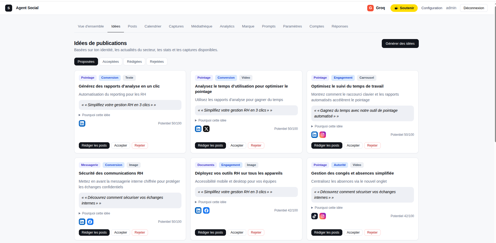
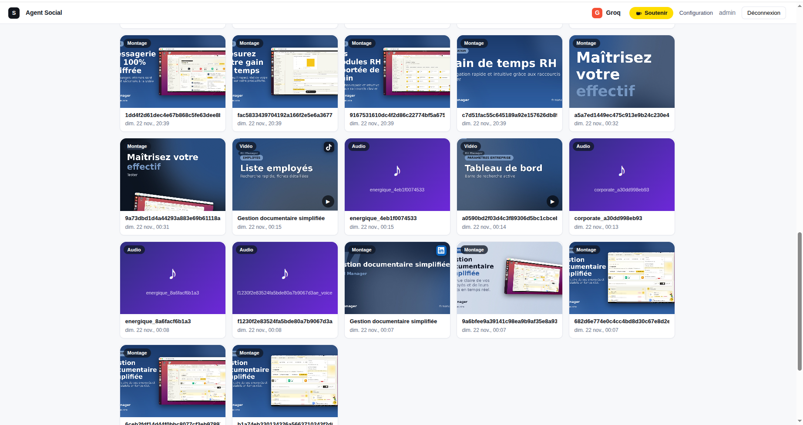
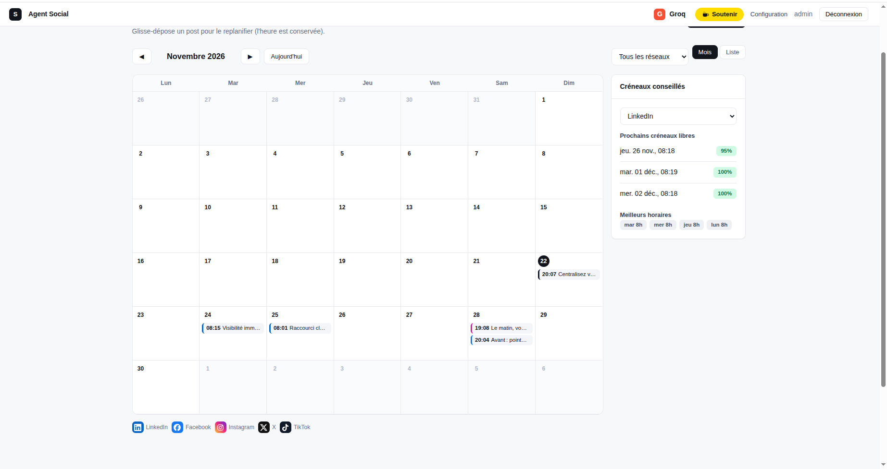
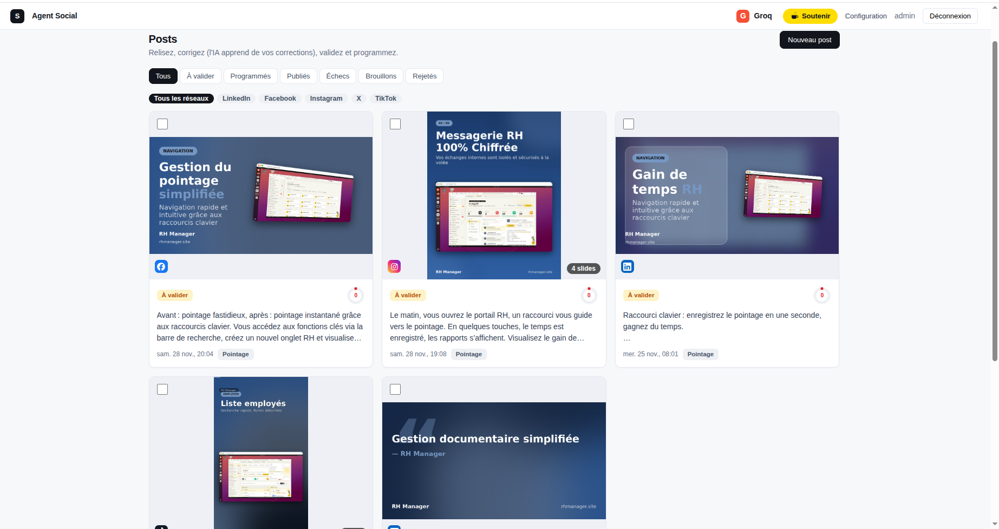
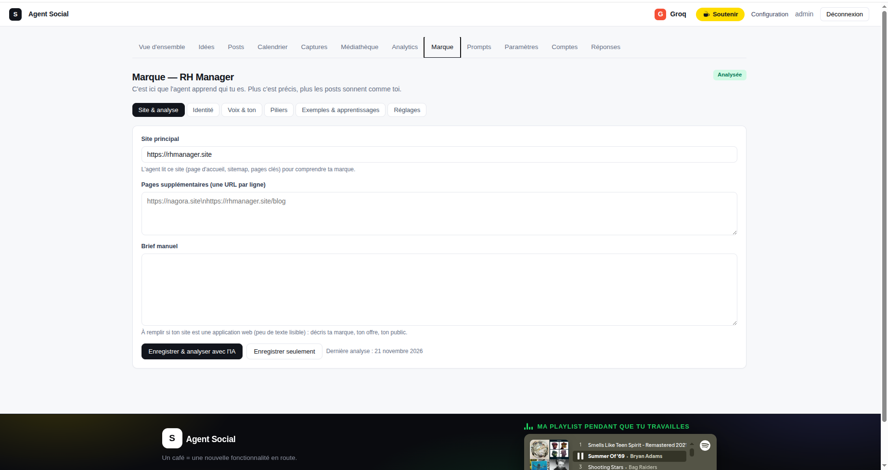
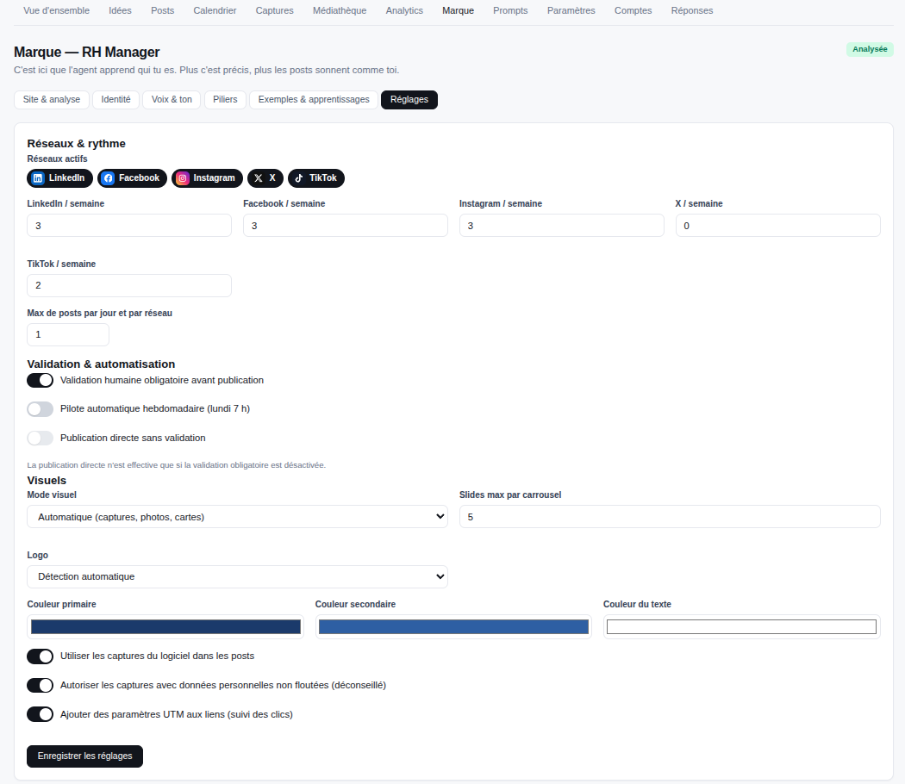

# Agent Social

**Ton community manager IA.** Il apprend ta marque (site, ton, piliers), propose des idées, rédige des posts natifs pour chaque réseau, fabrique les visuels et les vidéos, programme les publications au meilleur créneau, puis mesure les résultats pour s'améliorer.

Réseaux gérés : **LinkedIn · Facebook · Instagram · X · TikTok** (TikTok et Instagram via QPost ou jeton direct).



---

## Sommaire

- [Fonctionnalités](#fonctionnalités)
- [Aperçu](#aperçu)
- [Stack technique](#stack-technique)
- [Installation rapide (Docker)](#installation-rapide-docker)
- [Premier démarrage](#premier-démarrage)
- [Connecter les réseaux sociaux](#connecter-les-réseaux-sociaux)
- [Configuration](#configuration)
- [Fonctionnement interne](#fonctionnement-interne)
- [Développement local](#développement-local)
- [Structure du projet](#structure-du-projet)
- [Sécurité](#sécurité)
- [Dépannage](#dépannage)

---

## Fonctionnalités

### Stratégie et rédaction
- **Analyse de marque** : lecture du site (page d'accueil, sitemap, pages clés) pour extraire identité, ton de voix, personas et piliers éditoriaux.
- **Idées de posts** fondées uniquement sur les captures réelles du logiciel et les actualités du secteur (Serper). Toute idée qui s'appuie sur un fait absent des captures est rejetée.
- **Rédaction native par réseau** : une version différente par plateforme (longueur, accroche, hashtags, CTA).
- **Garde-fous anti-invention** : chiffres, clients, fonctionnalités et dates non sourcés sont refusés, tout comme les formules cliché.
- **Apprentissage continu** : tes corrections de posts, tes rejets et les posts les plus performants nourrissent le style de la marque.

### Visuels et vidéo
- **13 modèles de montage** : capture cadrée, zoom, carrousel, photo + titre, carte de marque, capture 3D, verre dépoli, duo, liste de points, titre géant, citation, vidéo animée.
- **Analyse vision des captures** : description, module, hashtags, zone de zoom et **zones sensibles floutées automatiquement** (nom, salaire, email…).
- **Vidéos verticales** (TikTok / Reels) : scènes animées, transitions, musique générée, sous-titres incrustés et voix off gratuite (edge-tts).
- **Photos libres** Unsplash / Pexels avec crédit automatique.

### Publication et suivi
- **Validation humaine** avant publication (désactivable).
- **Calendrier éditorial** en glisser-déposer, avec créneaux optimaux calculés (référence sectorielle puis tes propres stats).
- **Pilote automatique** : chaque lundi à 7 h, rapport, idées et rédaction de la semaine.
- **Analytics** : engagement, croissance des abonnés, meilleurs horaires, anomalies, rapports IA et **simulateur de performance**.
- **Assistant de réponses** aux commentaires, avec désescalade pour les critiques.

### Administration
- **Prompts éditables à chaud** depuis l'interface.
- **Suivi réel de la consommation IA** (tokens, coût estimé), budgets et plafonds.
- **Pool de clés API** avec rotation automatique : une clé épuisée ou invalide est écartée et la suivante prend le relais.
- Configuration complète dans l'interface, sans éditer de fichier.

---

## Aperçu

### Idées et rédaction


### Posts et éditeur de visuel



### Calendrier éditorial


### Médiathèque



### Marque



### Comptes connectés


### Consommation IA


---

## Stack technique

| Couche | Technologies |
|---|---|
| **Backend** | Python 3.11, FastAPI, Uvicorn, SQLModel / SQLAlchemy async, SQLite (WAL) |
| **IA texte** | API compatible OpenAI (Groq par défaut) avec pool de clés |
| **IA vision** | Groq (analyse des captures) |
| **Images** | Pillow, NumPy |
| **Vidéo / audio** | ffmpeg, edge-tts, synthèse musicale NumPy |
| **Frontend** | React 18, TypeScript, Vite, React Router |
| **Déploiement** | Docker (build multi-étapes) + docker-compose |

Aucune dépendance Redis ou Celery : les tâches de fond et le planificateur tournent dans le processus FastAPI.

---

## Installation rapide (Docker)

**Prérequis** : Docker et Docker Compose, un domaine en **HTTPS** (les réseaux téléchargent les médias depuis ton URL publique).

```bash
git clone https://github.com/Ratonpeureu/agent_comunity_m.git
cd agent_comunity_m
docker compose up -d --build
```

L'application écoute sur `http://localhost:8080` (modifiable avec `HOST_PORT` et `PORT`).

Les données (base SQLite, configuration, captures, médias générés) sont stockées dans `./data`, monté sur `/data` dans le conteneur. **Sauvegarde ce dossier.**

> Le conteneur s'arrête volontairement après l'enregistrement du premier `/setup` ; `restart: unless-stopped` le relance automatiquement.

---

## Premier démarrage

1. Ouvre `http://localhost:8080` : tu es redirigé vers **`/setup`**.
2. Renseigne :
   - l'identifiant et le mot de passe administrateur (8 caractères minimum) ;
   - l'**URL publique** HTTPS de l'application ;
   - le nom et le site de la marque ;
   - (optionnel) une clé API Groq.
3. Valide. L'application redémarre et génère automatiquement la clé de chiffrement des jetons et le secret JWT.
4. Connecte-toi, puis suis la checklist de démarrage de la **Vue d'ensemble** :
   1. Analyser la marque ;
   2. Connecter au moins un réseau ;
   3. Analyser les captures du logiciel ;
   4. Générer des idées et créer un premier post.

Ensuite, tout se règle dans **Paramètres › Configuration**.

---

## Connecter les réseaux sociaux

Méthode recommandée : **coller un jeton d'accès** dans l'onglet **Comptes**. Aucune application OAuth à configurer. Les jetons sont chiffrés (Fernet) côté serveur.

| Réseau | Ce qu'il faut |
|---|---|
| **Facebook** | Jeton avec `pages_show_list`, `pages_manage_posts`, `pages_read_engagement` (Pages uniquement). Il est converti en jeton de Page longue durée si `META_APP_ID` / `META_APP_SECRET` sont définis. |
| **Instagram** | Compte Professionnel ou Créateur. Jeton Instagram Login, ou réutilisation de la Page Facebook liée. |
| **LinkedIn** | Jeton avec `openid profile w_member_social` (+ `w_organization_social` pour une Page). |
| **X** | Jeton OAuth 2.0 utilisateur (`tweet.write users.read media.write`). Compte développeur avec crédits. |
| **TikTok** | Via **QPost** (qpost.dev) : renseigne `QPOST_API_KEY` puis « Synchroniser depuis QPost ». Jeton direct possible (avancé). |

La connexion OAuth classique reste disponible en option (section « avancé » de l'onglet Comptes).

---

## Configuration

Toutes les variables se modifient dans **Paramètres › Configuration** (stockées dans `/data/config.json`). Les principales :

| Variable | Rôle |
|---|---|
| `PUBLIC_BASE_URL` | URL publique HTTPS (obligatoire) |
| `SOCIAL_TZ` | Fuseau horaire (défaut `Africa/Dakar`) |
| `GROQ_API_KEY` | Clé IA de secours (les clés multiples se gèrent dans « Clés API ») |
| `LLM_BASE_URL` / `LLM_MODEL` | Autre fournisseur compatible OpenAI |
| `SERPER_API_KEY` | Actualités du secteur (optionnel) |
| `UNSPLASH_ACCESS_KEY` / `PEXELS_API_KEY` | Photos libres (optionnel) |
| `QPOST_API_KEY` | Publication TikTok / Instagram via QPost |
| `META_APP_ID` / `META_APP_SECRET` | Jetons Meta longue durée |
| `SOCIAL_VOICE` | Voix off (défaut `fr-FR-DeniseNeural`) |

Le réglage **Marque › Réglages** gère la cadence hebdomadaire par réseau, la validation obligatoire, le pilote automatique, les couleurs, le logo et les options de visuel.

---

## Fonctionnement interne

```
Site + brief ──► Analyse de marque ──► Identité · Ton · Piliers
                                            │
Captures ──► Vision IA ──► Catalogue ───────┤
Actualités (Serper) ────────────────────────┤
                                            ▼
                              Idées (sourcées, dédoublonnées)
                                            ▼
                     Rédaction native par réseau + contrôle anti-invention
                                            ▼
                         Montage visuel / vidéo ──► Prédiction de performance
                                            ▼
                      Validation ──► Programmation (créneau optimal)
                                            ▼
                               Publication ──► Métriques ──► Rapports
                                            ▲                    │
                                            └──── Apprentissages ┘
```

**Planificateur interne** (`agent/scheduler.py`) :

| Tâche | Fréquence |
|---|---|
| Publication des posts échus | chaque minute |
| Collecte des métriques | toutes les heures |
| Instantané des abonnés | toutes les 6 h |
| Rafraîchissement des jetons | toutes les 12 h |
| Scan des nouvelles captures | toutes les 6 h |
| Pilote automatique | lundi à 7 h (heure locale) |

---

## Développement local /// Fork depuis GITHUB

**Frontend** (proxy vers l'API sur le port 8080) :

```bash
cd frontend
npm install
npm run dev
```

**Backend** : l'utilisation de Docker est recommandée, car le code attend `/app/uploads/social` et `/data`. Hors Docker, définis `DATA_DIR`, `STATIC_DIR` et crée le lien symbolique correspondant :

```bash
pip install -r requirements.txt
export DATA_DIR=./data PYTHONPATH=.
python -m agent.run
```

ffmpeg doit être installé pour les vidéos.

---

## Structure du projet

```
.
├── agent/
│   ├── main.py                    # App FastAPI, routes, SPA
│   ├── run.py                     # Point d'entrée Uvicorn
│   ├── bootstrap.py               # Chargement de /data/config.json
│   ├── setup_app.py               # Page de premier démarrage (/setup)
│   ├── config_schema.py           # Schéma de configuration
│   ├── scheduler.py               # Planificateur interne
│   ├── db.py                      # Modèles SQLModel (SQLite)
│   ├── routes/                    # API admin (social, assets, connect, ai, config)
│   ├── tasks/social/              # Jobs asynchrones
│   └── services/
│       ├── llm_client/            # Client LLM + suivi de consommation
│       └── social/                # Agent, analytics, montage, vidéo,
│                                  # musique, publishers, gateway, assets…
├── frontend/
│   ├── src/
│   │   ├── assets/                # Captures d'écran, logo
│   │   ├── components/            # Layout, Footer
│   │   ├── lib/                   # api, auth, social, config, ai
│   │   └── pages/social/          # Pages de l'application
│   └── vite.config.ts
├── Dockerfile
├── docker-compose.yml
└── requirements.txt
```

---

## Sécurité

- Mot de passe administrateur haché (PBKDF2-SHA256, 200 000 itérations) ; limitation des tentatives de connexion.
- Authentification par jeton JWT ; toutes les routes d'administration sont protégées.
- Jetons des réseaux sociaux et clés API **chiffrés** (Fernet) au repos.
- `config.json` écrit avec les droits `600`.
- Captures contenant des données personnelles **exclues automatiquement** tant que les zones sensibles ne sont pas floutées.
- Ne publie **jamais** le dossier `data/` (il est dans `.gitignore`).

---

## Dépannage

| Problème | Piste |
|---|---|
| Les réseaux ne récupèrent pas les médias | `PUBLIC_BASE_URL` doit être en **HTTPS** et joignable depuis Internet (bouton « Vérifier » dans Configuration). |
| Aucune vidéo générée | Vérifie `ffmpeg` dans **Paramètres › Système** (inclus dans l'image Docker fournie). |
| « Aucune clé IA disponible » | Ajoute une clé dans **Paramètres › Clés API** ou dans Configuration. |
| Jeton Facebook expirant au bout d'1 h | Renseigne `META_APP_ID` et `META_APP_SECRET`, puis reconnecte. |
| Aucune capture exploitable | Analyse tes captures (onglet Captures) et floute les zones de données personnelles. |
| Un redémarrage interrompt un job | Les jobs en cours sont marqués « échec » au redémarrage : relance-les. |

---
